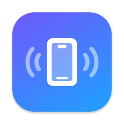

<p align="center"></p>

<h1 align="center">Splurter</h1>

<p align="center"><b>Continuity for Android and Mac.</b><br>
Scan a QR code once. Your phone's clipboard, notifications, calls, texts, files and screen then work with your Mac,
directly over your Wi-Fi, end-to-end encrypted. No account and no cloud.</p>

---

## What it does

| Feature | What you get | Status |
|---|---|---|
| **Pairing** | One QR scan, then it reconnects by itself (Bonjour discovery; verified across app restarts and a phone reboot). | ✅ |
| **Clipboard** | Copy on the Mac and paste on the phone. Phone to Mac with a button or the share sheet. | ✅ ¹ |
| **Media & volume** | Now-playing card on the Mac with cover art, a draggable progress bar, play/pause/next/previous, a switcher between players, and a volume slider that follows the phone's volume keys. | ✅ |
| **Notifications** | Phone notifications appear as native Mac banners with the app's icon. Dismiss on the Mac clears them on the phone. Reply from the banner for apps that offer inline reply. | ✅ ² |
| **Calls** | Incoming-call popup on the Mac with the caller's name and Answer or Decline. Dial from the Mac. | ✅ |
| **Texts** | Send an SMS from the Mac. Incoming texts arrive as notifications. | ✅ |
| **Files** | Drag files onto the menu-bar popover to send to the phone. Share from the phone to send to the Mac. | ✅ |
| **Screen mirroring + control** | A Mac window shaped like your phone (its corner radius and camera hole). Click, drag, scroll and type into it. It works while the phone is locked or on its always-on display, with no prompt on the phone. Once you start using it, the phone's own screen switches off (like iPhone Mirroring) and comes back when you close the window. It uses the same wireless-debugging setup as call audio; without it, a basic screen-share mirror (approved on the phone each time) is the fallback. | ✅ |
| **Call audio on the Mac** | Talk on a cellular call through the Mac: the caller plays on the Mac and your Mac mic goes into the call. | 🧪 beta ³ |
| **Phone as webcam** | Use the phone camera as a Mac camera. | ⏳ not built ⁴ |

¹ Android 10+ blocks background clipboard reads, so phone to Mac is deliberately a button or share action.
² Reply was built but is untested against a real chat app. Apps must expose an inline-reply action.
³ Works on a real call (Pixel 9a, Android 17) after a one-time Wireless debugging setup, with no extra hardware and no root. Tested on one phone. See [Call audio](#call-audio-beta).
⁴ Needs a macOS Camera Extension, which must be signed with an Apple Developer team ID.

## How it works

```
 Android (Kotlin / Compose)                           macOS (Swift / SwiftUI)
 ┌──────────────────────────┐   Bonjour _splurter._tcp   ┌──────────────────────────┐
 │ foreground service        │ ◄────────────────────────► │ menu-bar app             │
 │ notification listener     │   direct TCP on your LAN   │ native banners + popup   │
 │ call / SMS / files        │   X25519 · ChaCha20-Poly1305│ clipboard · mirror window│
 │ MediaProjection (mirror)  │ ◄────────────────────────► │ VideoToolbox decode      │
 └──────────────────────────┘      one multiplexed link    └──────────────────────────┘
```

The Mac shows a QR code holding its address, a public key and a single-use token. The phone scans it, and both sides derive session keys with four X25519 key agreements. After pairing each side remembers the other's key, so reconnecting needs no QR. Everything (messages, files, video) travels as encrypted frames on that one link. Details: [docs/PROTOCOL.md](docs/PROTOCOL.md).

## Install

Build the artifacts yourself (see [Build](#build)); there are no prebuilt releases yet.

**Mac** (macOS 15+): open `Splurter-<version>.dmg` and drag Splurter to Applications. The app is ad-hoc signed and not notarized, so the first launch needs right-click, then Open (or System Settings, Privacy & Security, Open Anyway). Allow notifications when asked.

**Android** (13+): install `Splurter-<version>.apk` (allow installs from your file manager or browser). Open the app and use the **Features** list to grant what you want:

| Feature | What to enable |
|---|---|
| Notifications | Notification access for Splurter |
| Calls, Texts, Contacts | The phone, SMS and contacts permissions |
| Screen control | Accessibility service (see below) |

**Screen control** is an Android accessibility service. For a sideloaded app Android blocks it until you open Settings, Apps, Splurter, the **⋮** menu, **Allow restricted settings**, then Settings, Accessibility, Splurter, switch on. The phone only acts on remote input while a mirroring session you approved is running.

## Pair

1. Click the Splurter icon in the Mac menu bar and choose **Pair a phone** (a window with a QR code opens on first run).
2. In the phone app, tap **Scan QR code** and point it at the Mac screen.

Done. After that, both apps reconnect on their own whenever they are on the same network.

## Call audio (beta)

Talk on a normal phone call through your Mac: the caller plays in your Mac's headphones and your Mac microphone goes into the call.

**One-time setup** (press **Use Mac audio** on the call card and the Mac app walks you through it):
1. Splurter drives Android's `adb` tool. It uses one it finds (Android Studio's or Homebrew's) or, only if you press the button, downloads Google's platform-tools (about 13 MB).
2. On the phone: Settings, Developer options, turn on **Wireless debugging**, tap **Pair device with pairing code**, and type the 6-digit code into the Mac window. (No Developer options? Tap Build number 7 times in About phone.)

**Using it:** during a call, press **Use Mac audio** in the Splurter menu (allow the microphone prompt the first time). It stops by itself when the call ends. While it runs, the phone's own microphone is muted so only your Mac voice goes out; it is unmuted afterwards.

**Best results:** wired earbuds with a microphone. Bluetooth headphones add about a quarter second of delay, a Mac's built-in mic is quiet, and Mac speakers would echo into the call (there is no echo cancellation yet). The call card shows a hint for your current setup, and the phone app has a **Call audio** row that shows whether Wireless debugging is on.

**How it works:** Android keeps cellular call audio away from apps, but the adb shell user holds permissions apps lack. Splurter starts a small helper on the phone as that user, over wireless debugging. It captures the caller (`VOICE_DOWNLINK`) and plays your voice into the call uplink using the system `CALL_ASSISTANT` usage. The helper talks to the Mac over a socket that adb forwards, with a random name and a one-time token. Details and the measurements behind the tuning: [native/callbridge/README.md](native/callbridge/README.md).

## Build

Needs Xcode (Swift 6 toolchain, macOS 15 SDK; built and tested with Xcode 27) and Android Studio (for its JDK and SDK).

```bash
cd native
./package.sh                 # builds release/Splurter-<ver>.dmg and release/Splurter-<ver>.apk
./mac/build_app.sh --install # or: build the Mac app and install it into /Applications
```

Android only: `cd native/android && ./gradlew :app:assembleDebug` (set `JAVA_HOME` to Android Studio's bundled JDK). For release builds, create `native/android/keystore.properties` and a keystore as described in [CONTRIBUTING.md](CONTRIBUTING.md); both files are git-ignored.

## Project layout

```
native/
  mac/        Swift package + build_app.sh   (Link, Crypto, Notifier, Mirror, App UI)
  android/    Gradle project                 (Link, NotifService, Phone, Files, Mirror, Control, Audio, Compose UI)
  callbridge/ phone-side call-audio helper (bundled into the Mac app) and a dev client
  icons/      make_icons.swift               (generates the Mac .icns and the Android icon layers)
  package.sh  release packaging
docs/         protocol and project docs
```

## Known limits

- **Call audio (beta).** It needs Wireless debugging, which Android can switch off by itself (after a Wi-Fi change or a reboot); the app restarts adb once and retries, then asks you to turn it back on. It has only been tested on one phone (Pixel 9a, Android 17), and other makers' builds may differ. No echo cancellation, so use headphones. Bluetooth routes were also tried and do not work on macOS: it refuses hands-free call audio, and its Bluetooth controller rejects the connection timing Android's hearing-aid protocol demands.
- **macOS 27 audio engine.** Voice processing and playback cannot run in one `AVAudioEngine` on macOS 27 (error -10875), so call audio uses separate capture and playback engines (and macOS voice processing stayed off).
- **Clipboard.** Phone to Mac cannot be automatic on Android 10+.
- **Mirroring.** The full mirror needs Wireless debugging (same limits as call audio) and has only been tested on a Pixel 9a. It has not been tried on a phone with a PIN or on secure screens, which block capture by design. The basic fallback mirror fixes its video size at start (no rotation) and sends dragging on release.
- **Typing into the mirror** appends to or deletes from the end of the focused field (no cursor positioning).
- **Single Mac per phone**, and one active phone connection at a time on the Mac.
- **Untested:** switching Wi-Fi networks, and replying to a real chat notification.

## Troubleshooting

- **Screen control won't switch on.** Allow restricted settings first (see Install). Reinstalling the app switches accessibility services off again.
- **No banners on the Mac.** Allow notifications for Splurter in System Settings, Notifications, and check Focus modes.
- **Blank icon on banners.** macOS caches notification icons per bundle ID and per registered copy of the app. Use `./mac/build_app.sh --install`, which keeps a single registered copy.
- **Phone does not reconnect.** Both devices must be on the same network and the Mac app must be running. Android reconnects with backoff up to 30 seconds.
- **Android stops the service** on aggressive vendor skins: exempt Splurter from battery optimisation.

- **"Use Mac audio" says the phone isn't reachable.** Turn Wireless debugging on again (Developer options) with the phone on the same Wi-Fi as the Mac. If it was paired before, there is no need to pair again.
- **Something else is wrong with call audio.** The app logs each step to `~/Library/Application Support/Splurter/call-audio.log`.

## Contributing and security

See [CONTRIBUTING.md](CONTRIBUTING.md) and [SECURITY.md](SECURITY.md).

## License

MIT, see [LICENSE](LICENSE).
